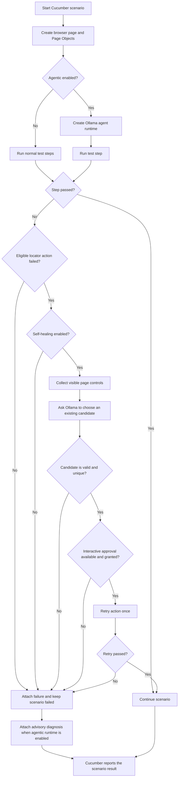

# Agentic testing in this framework

This project uses Playwright, TypeScript, and Cucumber. Agentic features add AI assistance around browser tests; they do not replace Cucumber assertions or decide whether a test passed.

## What happens when a scenario runs

1. Cucumber creates a browser page and its Page Objects.
2. With `AGENTIC_TESTS_ENABLED=true`, the scenario gets an Ollama-backed agent runtime.
3. If an eligible Page Object locator action fails, and self-healing is enabled, the framework gathers visible page controls and asks the model to select a replacement from those candidates.
4. The framework checks that the suggested locator identifies exactly one visible, enabled control. In a serial interactive terminal, it asks for approval before retrying once.
5. If a scenario step still fails, the agent can provide a short diagnosis. The diagnosis is attached to the Cucumber report; it does not change the test result.

The model is not allowed to invent a locator that the framework will use directly. Candidate validation and the approval gate remain in place.

### Flow at a glance



In this diagram, “eligible locator action” means a `click`, `fill`, or `press` that timed out because the original locator matched no elements, while the page URL stayed the same. A successful retry lets the scenario continue; the agent does not rewrite the test or its locators.

## Enable it

Set these in `.env`:

```env
AGENTIC_TESTS_ENABLED=true
AGENTIC_SELF_HEALING_ENABLED=true
OLLAMA_BASE_URL=http://127.0.0.1:11434
OLLAMA_MODEL=qwen3:4b
```

Start Ollama and make sure the model is available before running Cucumber:

```sh
brew services start ollama
ollama pull qwen3:4b
npm run cucumber
```

If Ollama is unavailable, the original test failure is preserved; model assistance cannot select a locator or provide a diagnosis. Recovery is limited to `click`, `fill`, and `press` locator actions when the original locator times out with no matching elements and the page URL has not changed. Assertions are not rewritten.

Interactive approval requires a serial run with an available TTY. If approval is unavailable—including parallel Cucumber workers—the framework reports the suggestion and does not retry. `HEADLESS=true` alone does not determine whether approval is possible.

## What is implemented—and what is not

| Capability | Current behavior |
|---|---|
| Failure diagnosis | Ollama receives a bounded failure summary and returns advisory text. The first failed step per scenario is diagnosed. |
| Locator self-healing | Ollama selects from locally discovered candidates; the framework validates the choice and requires approval for one retry. |
| Skills | Typed, read-only skill definitions are centralized in `src/agentic/skills/skills.ts`. They are not yet wired into the Cucumber runtime. |
| Rules | A policy parser, rules engine, and disabled example policy exist. They do not currently control Cucumber diagnosis or locator recovery. |
| Memory | In-memory and optional file-backed stores exist. Cucumber does not currently load or use them. |
| Test generation and repair | Automatic Gherkin-to-step/Page Object generation, file editing, test execution loops, and automatic code repair are not implemented. |
| Retrieval and vector search | Knowledge, RAG, embedding, and vector-store contracts exist, but there are no working adapters. |

That means the current Cucumber integration calls the Ollama provider directly for diagnosis and locator selection. The more general agent, skill, rules, and memory modules are foundations for future work—not a complete autonomous test-generation system.

## Interview-ready explanation

> “I built an opt-in agentic layer around a Playwright and Cucumber framework. It uses a local Ollama model to diagnose failed steps and suggest locator recovery from controls already found on the page. The framework validates the suggestion and requires approval before a single retry, while Cucumber remains the source of truth for pass or fail. I also added typed skill, policy, and memory foundations, but those are not yet connected to the Cucumber runtime. Automatic test-code generation and repair are future work.”

## Where to look

- `support/hooks.ts` — creates and disposes scenario resources, attaches failure analysis, and provides the wrapped Page to Page Objects.
- `support/agentic-runtime.ts` — sends diagnosis and locator-selection requests to Ollama.
- `src/agentic/integrations/cucumber/locator-recovery.ts` — detects eligible locator failures, gathers candidates, validates suggestions, and enforces the retry boundary.
- `support/locator-recovery.ts` — handles model calls, interactive approval, and Cucumber report attachments.
- `src/agentic/skills/skills.ts` — centralized read-only skill definitions.
- `src/agentic/core/rules-engine.ts` and `src/agentic/config/rules.example.json` — policy enforcement code and disabled sample policy.
- `src/agentic/adapters/memory/` — in-memory and file-backed memory implementations.

## Checks

```sh
npm run build
npm test
npm run cucumber
```

The first two commands check types and deterministic agentic tests. `npm run cucumber` runs the browser scenarios and requires the configured test environment; agentic assistance also requires Ollama when enabled.
