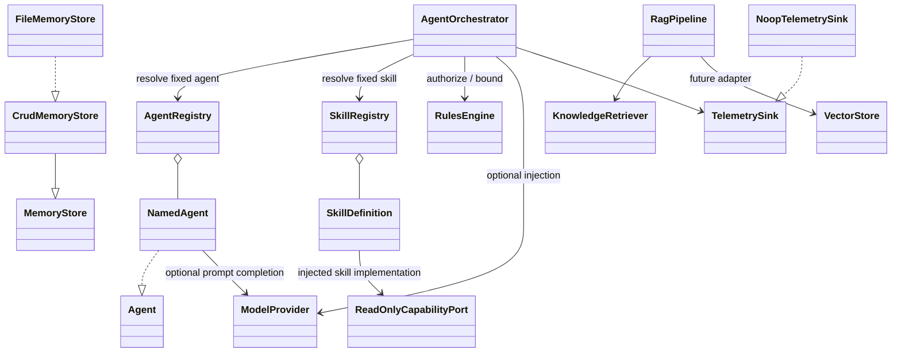

# Agentic testing foundation

This repository remains a Playwright + TypeScript + Cucumber test framework. Its agentic foundation is additive, provider-neutral, scenario-scoped, and disabled by default. Existing steps, assertions, browser lifecycle, and reports remain authoritative. No new runtime or package dependency is activated by importing these modules.

## Folder structure

```text
src/agentic/
  agents/named-agents.ts       Planner, Executor, Observer, Healing, Analysis, TestGeneration
  config/
    rules.example.json         Disabled, read-only example policy
    agent-prompts.json         Fixed, provider-neutral prompt templates
  contracts/                   Agent, skills, rules, providers, memory, RAG/vector, telemetry
  core/                        Registries, policy parsing, orchestration, POM capability
  adapters/
    memory/                    Ephemeral scenario store + explicit file-backed CRUD store
    telemetry/                 No-op telemetry adapter
  skills/                      Typed read-only capability wrappers
  integrations/cucumber/       World/lifecycle and narrow POM capability bindings
  tests/                       Deterministic contract, policy, memory, and boundary tests
support/
  hooks.ts                      Existing hooks; agentic lifecycle remains opt-in
  agentic-runtime.ts            Explicit runtime-factory seam; configure only by approval
docs/agentic-testing.md         This guide
```

### Implemented vs roadmap

| Area | Implemented now | Not implemented / roadmap |
|---|---|---|
| Agents | Six typed named agents with fixed skill bindings and optional injected `ModelProvider` | No autonomous tool choice, multi-agent planning loop, retries, or pass/fail authority |
| Skills | Typed wrappers for navigation, form, validation, locator, API, database, visual, accessibility, auth, reporting, analysis, planning, and test proposals; wrappers declare `read` side effects | No concrete generic browser/API/database adapter; caller must inject reviewed, allowlisted ports |
| Rules/prompts | Bounded JSON policy parser; disabled example policy; fixed JSON prompt templates | No remote prompt registry or untrusted runtime prompt override |
| Memory | Existing in-process TTL store plus `FileMemoryStore` CRUD/list/scoped substring search, atomic file replacement, expiry, and configurable hard limits | No encryption, cross-process transaction/locking, distributed store, semantic search, external RAG, or vector database |
| Knowledge/retrieval | Provider-neutral knowledge, embedding, RAG, and vector-store interfaces | No ingestion, embedding, retrieval, ranking, or vector persistence implementation |
| Telemetry | Best-effort orchestrator boundary and no-op sink | No remote telemetry adapter or exporter |
| Integration | Existing explicit Cucumber lifecycle and separately opt-in fixed read-only POM actions | No automatic wiring of the named agent registry or skills into the runtime factory |

## Interfaces and class relationships

`AgentOrchestrator` obtains a plan from an `Agent`, then authorizes the agent and its fixed registered skill through `RulesEngine`, validates the skill input/output, enforces per-run input/call/deadline limits, and emits best-effort telemetry. A `NamedAgent` can call a provider only when the caller injects one into the orchestrator; without it, the fixed skill receives the supplied task without an AI call. Each named agent has a compile-time fixed skill ID, so model text cannot select tools. `SkillRegistry` and the policy allowlist remain authoritative.



`KnowledgeSource`, `KnowledgeRetriever`, `EmbeddingProvider`, `RagPipeline`, and `VectorStore` are contracts only. The diagram does not imply live RAG/vector integrations. `FileMemoryStore` serializes operations within one instance, hashes scope identifiers into filenames, validates persisted JSON and limits, uses private temp-file permissions and rename-based replacement, and applies TTL. It requires an explicit root directory and is not a multi-process database.

## Named agents and skills

| Agent | Fixed skill | Intended authority |
|---|---|---|
| `planner` | `analysis.plan` | Draft a read-only analysis plan |
| `executor` | `validation.observe` | Request a registered read-only validation |
| `observer` | `visual.observe` | Summarize an approved observation request |
| `healing` | `locator.suggest-recovery` | Suggest a locator hypothesis for review; does not heal |
| `analysis` | `analysis.review` | Analyze supplied evidence |
| `test-generation` | `test-generation.propose` | Draft a test proposal for human review |

Every skill wrapper accepts a bounded `request` string and returns a bounded `summary`; its injected `ReadOnlyCapabilityPort` receives only that typed input and a minimal run context. API/database implementations must enforce fixed read-only queries/endpoints and must not accept arbitrary SQL, URLs, credentials, or raw browser objects. The visual skill is only an interface wrapper: no screenshot ingestion or visual AI is included. The auth wrapper handles summaries only and never credentials.

## Integration and workflow

1. Leave `AGENTIC_TESTS_ENABLED` unset/false to keep the established Cucumber execution path. The default does not invoke an agent provider.
2. Obtain approval for the data boundary and provider before configuring a runtime. Parse a policy using `parseAgentPolicy`; begin with `rules.example.json` and change `enabled`/allowlists only for reviewed, required agent and skill IDs.
3. Explicitly instantiate `createNamedAgentRegistry()`, register only needed skills with concrete reviewed ports in `SkillRegistry`, and inject the chosen provider, memory, and telemetry implementations into the runtime. Importing the registry alone does not call a provider.
4. Configure the explicit runtime factory in `support/agentic-runtime.ts` and enable `AGENTIC_TESTS_ENABLED=true` only when authorized. Enabling the flag without a configured factory intentionally fails rather than selecting a vendor.
5. To pass a POM capability, separately set `AGENTIC_POM_CAPABILITIES_ENABLED=true` and configure the exact `AGENTIC_POM_ALLOWED_ACTIONS` names (for example `dashboard.verify-menu,dashboard.verify-menu-hidden`). Current POM operations are read-only and bounded; no `Page`, `BrowserContext`, POManager, locator, or complete World is passed through the capability.
6. Scenario hooks create/dispose runtime state. Any failure diagnosis is bounded, best-effort, supplementary, and cannot alter Cucumber assertions or status. Do not treat basic regex redaction as a guarantee.
7. Verify deterministic contracts with `npm test` and compile with `npm run build`; existing browser scenarios remain `npm run cucumber` and require the repository's approved target/environment configuration.

## Memory CRUD example

The persistent adapter has no default path and is never wired into hooks automatically:

```ts
const memory = new FileMemoryStore({
  rootDir: approvedPrivateDirectory,
  maxScopes: 250,
  maxEntriesPerScope: 100,
  maxValueChars: 4_000,
  defaultTtlMs: 30 * 60 * 1000
});
await memory.create({ kind: 'scenario', id: scenarioId }, { key: 'note', value: 'bounded observation' });
const matches = await memory.search(
  { kind: 'scenario', id: scenarioId },
  { query: 'observation', limit: 10 }
);
await memory.update({ kind: 'scenario', id: scenarioId }, 'note', { value: 'reviewed note' });
await memory.delete({ kind: 'scenario', id: scenarioId }, 'note');
```

`write` remains the base contract's upsert operation. `clear` deletes one complete scope. Search is case-insensitive substring matching within the specified scope only, not semantic/vector retrieval. Do not store credentials, session tokens, raw screenshots, full World/Page data, or sensitive test payloads. Treat persisted memory as sensitive even though values and entry counts are bounded.

## Dependencies, production, scaling, and security

- **Dependencies:** no package dependency was added for this increment. File persistence uses Node built-ins; TypeScript JSON imports use the repository's existing `resolveJsonModule` configuration.
- **Provider and spend:** provider-neutral `ModelProvider` is injected per orchestrator; no vendor SDK, key, network call, or implicit fallback is included. Prompt text is not a security boundary. A real provider adapter must redact/minimize inputs before transport, validate output, enforce token/cost quotas and deadlines, and keep credentials in a secret manager.
- **Skill safety:** `sideEffects: ['read']` and types are declarations, not sandboxing. Review concrete port code; expose only fixed allowlisted operations, enforce authorization at the adapter boundary, and never pass raw `Page`, `World`, SQL connection, arbitrary URL, file system, or shell capability.
- **Memory security:** pass an explicit private directory; the adapter uses restrictive temp-file mode, safe hashed filenames, file-size/count/value bounds, TTL cleanup on access, and atomic rename. It does not encrypt data or guarantee cross-process consistency. Production needs OS ACLs, encryption at rest, retention/deletion controls, backup policy, and a transactional store or distributed locking for multiple workers. Do not store secrets.
- **Scale/reliability:** keep per-scenario namespaces, bound concurrency and queue depth, propagate cancellation, cap model and telemetry latency, add quotas/backpressure/circuit breakers and retention controls, and scope any future remote memory/vector namespace by tenant. Current file operations serialize within one store instance; use a production database when parallel workers share storage.
- **Existing behavior/security:** AI advice is supplementary and cannot change test pass/fail. This increment does not change the existing TLS or hook logging behavior; review known repository security findings before enabling a real target/provider integration.

## Roadmap

1. **Foundation (implemented):** named provider-neutral agents, typed fixed-skill wrappers, JSON sample rules/prompts, parser and bounds, file CRUD memory, disabled-by-default integration, deterministic tests and documentation.
2. **Approved deterministic adapters:** implement selected read-only POM/API/database/validation ports, with explicit allowlists and adapter-level tests; verify against a mock before any approved target.
3. **Provider and retrieval:** select a vendor only after data/spend approval; add sanitization, schema-checked model output, model quotas, retrieval ingestion/tenant ACLs, and real vector/RAG adapters with security tests.
4. **Operations:** add encrypted persistent storage, audit/retention, multi-process coordination, telemetry export, dashboards and CI controls. Keep healing/test generation review-only unless separately governed.

## Known limitations

- No model/LLM vendor, remote provider, embedding, vector database, external RAG, remote telemetry, screenshot processing, or actual visual AI is implemented.
- The named agents can call an injected provider to transform a supplied task; without a provider they use deterministic input passthrough. They neither execute arbitrary tools nor mutate application/test state.
- Capability wrappers do not implement Playwright/API/DB access; injected implementations are trusted code and require separate review.
- File memory is local, opt-in, single-process, non-encrypted, and not a semantic search system.
- Cucumber browser journeys are not replaced by contract tests. Live target behavior needs an explicitly approved environment and is outside this increment.
